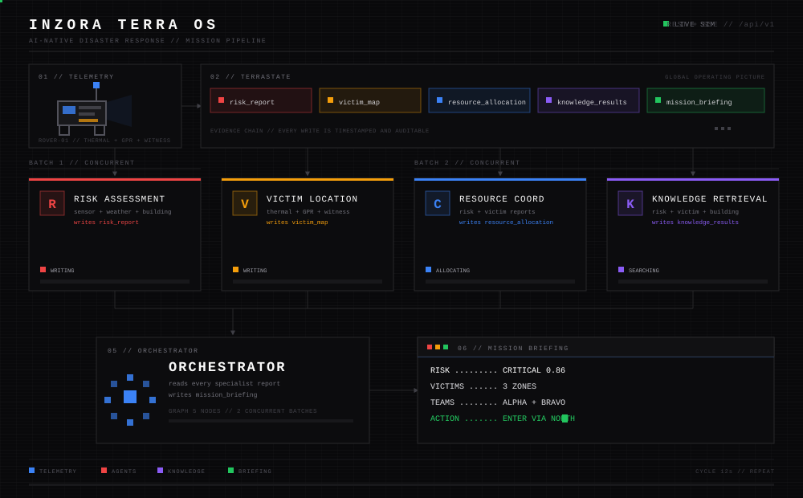
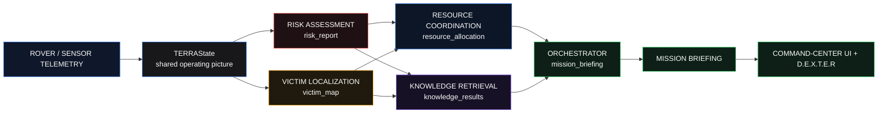

<div align="center">

# INZORA TERRA OS

**AI-Native Disaster Response Operating System**

Rover telemetry in. Rescue intelligence out.

<a href="https://github.com/AfrazAhamed24/inzora-terra"></a>
<a href="https://fastapi.tiangolo.com/"></a>
<a href="https://react.dev/"></a>
<a href="https://vite.dev/"></a>
<a href="https://tailwindcss.com/"></a>




**TELEMETRY &nbsp;→&nbsp; SHARED STATE &nbsp;→&nbsp; 2 CONCURRENT BATCHES &nbsp;→&nbsp; ORCHESTRATOR &nbsp;→&nbsp; MISSION BRIEFING**

**[Quick Start](#quick-start)** &nbsp;·&nbsp; **[How It Works](#how-it-works)** &nbsp;·&nbsp; **[Agent Roster](#the-agent-roster)** &nbsp;·&nbsp; **[API](#api-surface)** &nbsp;·&nbsp; **[Docs](#documentation-map)**

</div>


## What is Inzora Terra OS?

Inzora Terra OS is not a chatbot, not a dashboard, and not an AI wrapper. It is an **operating system for disaster response coordination**: a rover streams sensor data into a mission, specialized agents reason over it through a dependency graph, and an orchestrator turns their reports into field-ready rescue guidance.

> [!IMPORTANT]
> **One agent, one responsibility.** Every agent reads the shared mission state, writes exactly one structured report, and logs its reasoning. Nothing is hidden in a chat transcript.

| Layer | Technology | Start it with |
|-------|------------|---------------|
| Backend engine | Python, Pydantic, dependency graph | `python -m backend.run` |
| Mission API | FastAPI, REST + SSE | `python -m backend.api.main` |
| Command center | React 19, Vite 8, Tailwind v4, Framer Motion | `npm run dev` |
| Voice conductor | D.E.X.T.E.R + Web Speech API | Built into the UI |


## How It Works

The animation above is the whole product in 12 seconds. Here is the same pipeline in words:

1. **Telemetry arrives** — thermal, GPR, weather, building records, and witness reports enter the mission.
2. **TERRAState holds the truth** — one shared Global Operating Picture records every evidence entry, task, and agent output.
3. **Batch 1 runs concurrently** — the **Risk Assessment** and **Victim Localization** agents work independently and write `risk_report` + `victim_map`.
4. **Batch 2 runs concurrently** — **Resource Coordination** and **Knowledge Retrieval** consume those reports and write `resource_allocation` + `knowledge_results`.
5. **The Orchestrator synthesizes** — it reads every report, aggregates confidence, applies human-in-the-loop rules, and writes the final `mission_briefing`.
6. **The command center renders** — the UI streams the mission, agent activity, timeline, and Rescue Guidance panel live.



### Human-in-the-loop rules

| Trigger | System response |
|---------|-----------------|
| Risk score **> 0.8** | Alert the supervisor |
| Agent confidence **< 0.5** | Request manual verification |
| Multiple **HIGH** risk zones | Request resource-allocation approval |


## The Agent Roster

| Agent | Reads | Writes | Job |
|-------|-------|--------|-----|
| **Risk Assessment** | sensor, weather, building | `risk_report` | Scores structural risk `0.0–1.0` and lists hazards |
| **Victim Localization** | thermal, GPR, witness | `victim_map` | Builds zone-by-zone survivor probability |
| **Resource Coordination** | risk + victim reports, tasks | `resource_allocation` | Allocates teams and equipment to zones |
| **Knowledge Retrieval** | risk, victim, building | `knowledge_results` | Queries SOPs and building codes (prototype retrieval, **not** RAG) |
| **Rescue Coordination** | all specialist reports | `rescue_guidance` | Produces entry clearance, priority order, extraction techniques, triage + comms |
| **Orchestrator** | everything | `mission_briefing` | Runs the graph, aggregates confidence, writes the final briefing |

> [!NOTE]
> The Knowledge Retrieval agent is deliberately branded a **prototype**. It performs keyword retrieval today; embeddings and a vector store are future work.


## Quick Start

**Prerequisites:** Python 3.10+, Node.js 20+, and Git.

<details open>
<summary><b>macOS / Linux</b></summary>

```bash
git clone https://github.com/AfrazAhamed24/inzora-terra.git
cd inzora-terra

python -m venv .venv
source .venv/bin/activate
pip install -r backend/requirements.txt

cp .env.example .env

# Terminal 1 — mission API
python -m backend.api.main

# Terminal 2 — command center
cd frontend
npm install
npm run dev
```

</details>

<details>
<summary><b>Windows PowerShell</b></summary>

```powershell
git clone https://github.com/AfrazAhamed24/inzora-terra.git
Set-Location inzora-terra

python -m venv .venv
.\.venv\Scripts\Activate.ps1
pip install -r backend/requirements.txt

Copy-Item .env.example .env

# Terminal 1 — mission API
python -m backend.api.main

# Terminal 2 — command center
Set-Location frontend
npm install
npm run dev
```

</details>

Open **http://localhost:5173** and run a mission. The backend listens on **http://127.0.0.1:8000**.

> [!TIP]
> No keys are required for the demo. `GROQ_API_KEY` in `.env` only unlocks future LLM-backed agents. The current agents are rule-based, so the pipeline runs fully offline.

### Useful commands

```bash
python -m backend.run          # run the mission pipeline in the terminal
python -m pytest               # backend test suite
cd frontend && npm run build   # production build
cd frontend && npm run lint    # oxlint
```


## API Surface

All routes live under `/api/v1`.

| Method | Route | Purpose |
|--------|-------|---------|
| `GET` | `/health` | Liveness check |
| `GET` | `/version` | Build + version info |
| `POST` | `/missions` | Create a mission |
| `GET` | `/missions` | List missions |
| `GET` | `/missions/{id}` | Mission snapshot |
| `POST` | `/missions/{id}/start` | Start the agent graph |
| `POST` | `/missions/{id}/stop` | Stop the mission |
| `GET` | `/missions/{id}/summary` | Aggregated summary |
| `GET` | `/missions/{id}/timeline` | Mission timeline events |
| `GET` | `/missions/{id}/telemetry` | Telemetry snapshot |
| `GET` | `/missions/{id}/stream` | **SSE** live mission stream |
| `GET` | `/missions/{id}/replay` | Deterministic replay |
| `GET` | `/missions/{id}/decisions` | Pending HITL decisions |
| `POST` | `/missions/{id}/decisions/{decision_id}/resolve` | Resolve a HITL decision |
| `POST` | `/missions/{id}/assistant/chat` | Talk to D.E.X.T.E.R |


## Repository Map

```text
inzora-terra/
├── backend/              Python multi-agent pipeline + FastAPI mission API
│   ├── agents/           Risk, Victim, Resource, Knowledge, Rescue, Orchestrator
│   ├── orchestration/    Dependency graph, executor, HITL, replay, briefing
│   ├── simulation/       Synthetic rover, sensors, weather, scenarios
│   ├── api/              REST + SSE routes, services, schemas
│   └── tests/            Backend test suite
├── frontend/             React + Vite command-center UI
│   └── src/              Components, hooks, mission context, services
├── docs/                 Design system, workflow, specs, archive, assets
│   └── assets/           Animated pixel SVGs used by this README
├── ppt/                  Presentation content + generator script
├── vision-prototype/     Standalone INZORA-X vision system (isolated)
├── BLUEPRINT.md          Product source of truth (v1.1)
├── AGENTS.md             Agent behavior rules
├── MEMORY.md             TERRAState + permissions reference
└── opencode.json         Tool configuration
```


## D.E.X.T.E.R — The Voice Conductor

**D.E.X.T.E.R** (Disaster EXecutive Tactical Emergency Responder) is the single conversational surface. It narrates the mission like an operations officer:

- **Environment scan** → agents activate and report one by one → **cinematic final briefing**
- Voice input and output through the **Web Speech API** — no keys, offline-safe
- **Terra X** chat dock answers quick queries from live mission state: risk, victims, next actions, rescue guidance, who is working
- Try saying: *“Dexter, run the mission”*, *“Dexter, status”*, *“Dexter, show the briefing”*, *“Dexter, mute”*


## Documentation Map

| File | What it answers |
|------|-----------------|
| [`BLUEPRINT.md`](BLUEPRINT.md) | The complete product definition and phase plan |
| [`docs/WORKFLOW.md`](docs/WORKFLOW.md) | Agent execution model and dependency graph |
| [`docs/DESIGN.md`](docs/DESIGN.md) | Design tokens, panels, motion, and UI structure |
| [`docs/TOOLS.md`](docs/TOOLS.md) | Tool interfaces and data contracts |
| [`docs/specs/`](docs/specs/) | API, lifecycle, state, logging, simulation, and migration specs |
| [`docs/archive/PHASE-0.5-AUDIT.md`](docs/archive/PHASE-0.5-AUDIT.md) | Historical architecture audit |
| [`AGENTS.md`](AGENTS.md) | Agent roles, communication protocol, and HITL rules |


## Status & Roadmap

- [x] Dependency-graph engine with a shared TERRAState
- [x] FastAPI mission API with SSE streaming
- [x] React command center wired to the live API
- [x] Rescue Coordination Agent + field-ready guidance
- [x] D.E.X.T.E.R voice conductor and Terra X chat dock
- [x] Deterministic replay and HITL decisions
- [ ] LLM-backed agents and confidence calibration
- [ ] Real retrieval (embeddings + vector store)
- [ ] Wire `vision-prototype` into the mission as a sensor source
- [ ] Production deployment: Docker, auth, observability

<details>
<summary><b>Why is <code>vision-prototype/</code> separate?</b></summary>

It is a self-contained computer-vision server (YOLO, thermal, face, fire/smoke detection) used to verify perception independently. It is **not imported by the backend** and does not affect the mission pipeline. Run it on its own with `python vision-prototype/run.py`; its own `requirements.txt` lives inside the folder.

</details>

<details>
<summary><b>Does the demo need internet or API keys?</b></summary>

No. The demo runs offline with rule-based agents and simulated telemetry. `GROQ_API_KEY` is only used when LLM features are enabled.

</details>

<details>
<summary><b>Where does the UI get live updates?</b></summary>

The frontend subscribes to `GET /api/v1/missions/{id}/stream`, an SSE endpoint. The timeline and agent status update as the orchestrator emits events.

</details>

<div align="center">


**Built for the moments that matter.**

[Blueprint](BLUEPRINT.md) · [Workflow](docs/WORKFLOW.md) · [Design](docs/DESIGN.md) · [Specs](docs/specs/) · [Report an issue](https://github.com/AfrazAhamed24/inzora-terra/issues)

</div>
